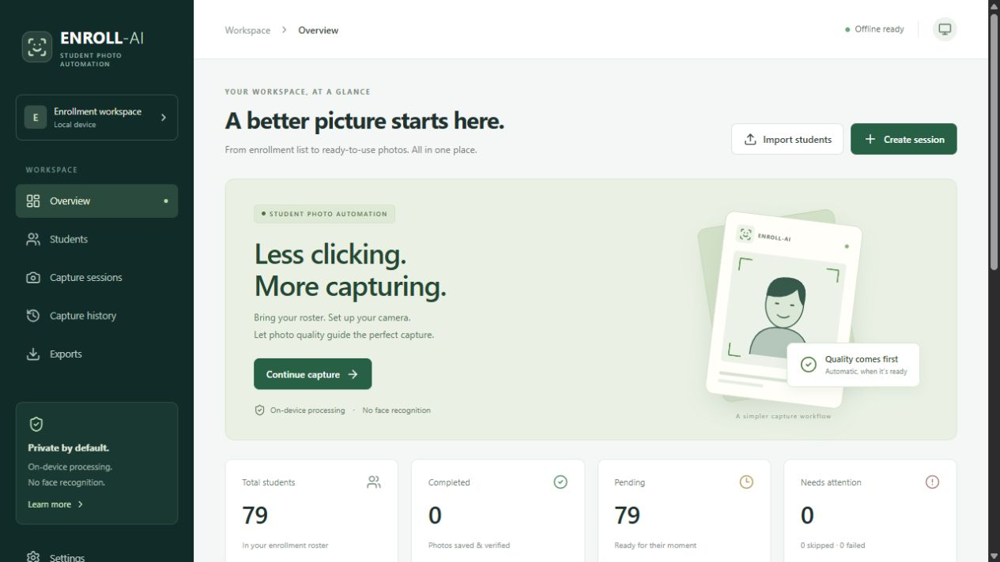
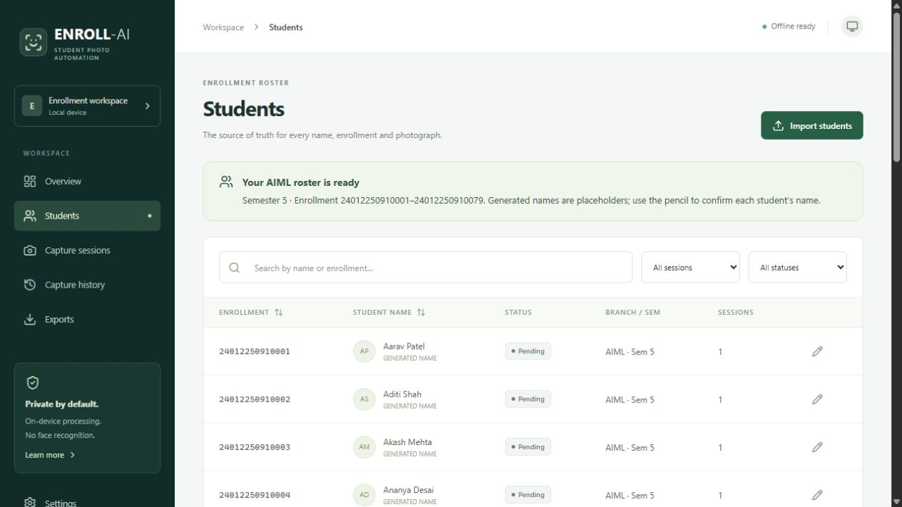
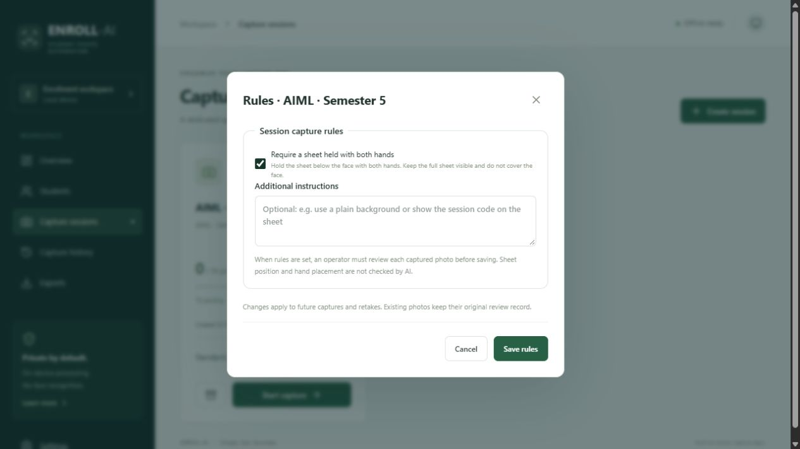
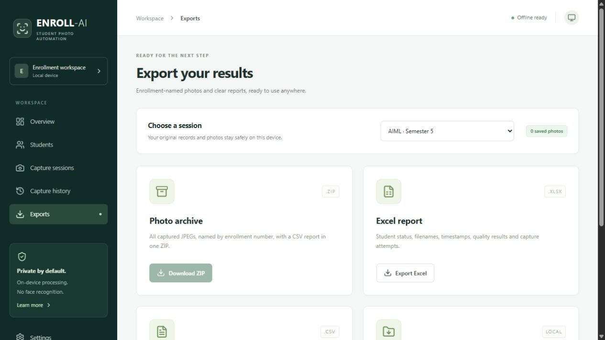
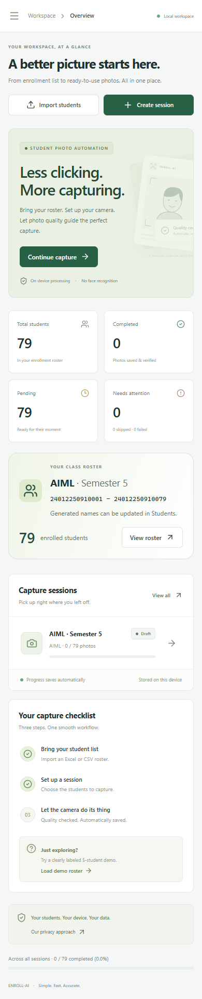
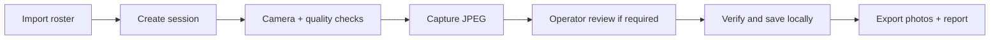

<p align="center">
  
</p>

<p align="center">
  <strong>AIML Group no. 3</strong><br>
  Student photo capture and enrollment management, built for the browser.
</p>

<p align="center">
  <a href="#see-the-app">Screenshots</a> ·
  <a href="#run-locally">Quick start</a> ·
  <a href="docs/AI_PIPELINE.md">AI pipeline</a> ·
  <a href="docs/USER_GUIDE.md">User guide</a>
</p>

---

## The idea

Capturing a class roster should not mean manually naming every photograph, tracking progress in a separate spreadsheet, and checking the same photo conditions over and over.

**ENROLL-AI brings that workflow into one place:** import students, organize a session, check the camera frame, review the photo, and export enrollment-named JPEGs with a report. Processing and storage happen on the device.

**Face detection checks the photo; the operator verifies the student.** This project does not perform face recognition or infer anyone’s identity.

## See the app

### A workspace for the whole capture day



### A searchable student directory



<details>
<summary><strong>Session rules, exports and mobile layout</strong></summary>

#### Set the requirements for each session



Sheet and hand placement are reviewed by an operator against the captured image before it is saved. They are not automatically detected.

#### Take the results with you



#### Use a smaller screen

<p align="center"></p>

</details>

*Screenshots show a local demonstration workspace with generated placeholder names. No real student photographs are included in this repository. The included sample roster contains 79 AIML Semester 5 enrollments; new capture statuses start Pending.*

## What it does

- **Import and organize:** XLSX/XLS/CSV import, column mapping, duplicate checks, searchable rosters and dedicated session queues.
- **Guide the camera:** MediaPipe face detection plus checks for face position, size, basic roll, lighting, sharpness and stability.
- **Automate carefully:** cancellable countdown, automatic capture, next-student frame-clear check, pause, skip, retry and explicit retakes.
- **Review session rules:** optional sheet requirements and custom instructions, with fresh operator confirmation for each photo.
- **Save consistently:** enrollment-based filenames, transactional IndexedDB storage, save verification and audit events.
- **Export clearly:** JPEG ZIP archives, Excel/CSV reports and supported-browser folder exports, including review evidence.
- **Work locally:** responsive PWA, offline app/model caching after the initial load, and no automatic photo uploads.

## How it works



**Built with:** React 19 · TypeScript · Vite · MediaPipe Tasks Vision · Dexie / IndexedDB · Tailwind CSS · JSZip · SheetJS.

The AI model detects faces. Deterministic image and timing checks determine capture readiness. The state machine keeps the selected enrollment, image, save result and queue progression together. Read the [AI pipeline](docs/AI_PIPELINE.md) and [database schema](docs/SCHEMA.md) for implementation details.

## Run locally

Use **Node.js 22.12+**, npm, and a current browser with camera, IndexedDB and Web Locks support. Development was verified with Node.js 24 and Chrome.

```bash
git clone https://github.com/ParamDer802/Enroll-AI.git
cd Enroll-AI
npm ci
npm run setup:vision
npm run dev
```

Open the localhost URL printed in the terminal and allow camera access when starting a capture session. Choose your laptop or USB webcam in the camera selector if the browser selects a virtual camera.

The model and WASM runtime are included. `setup:vision` checks the model checksum and prepares the pinned runtime. Camera capture requires **HTTPS or localhost**.

For a production preview with offline caching:

```bash
npm run build
npm run preview
```

Wait for **Offline ready** after the first production load. The hosted development preview uses restricted access; cloning the project is the reproducible way to review it.

## Verification

The latest full verification on **22 October 2026** passed **45 unit/integration tests**, **11 Chrome browser workflows**, and the production build. These are results of that run, not a live CI badge.

Coverage includes persistence and migration, transaction rollback, capture sequencing, camera recovery, session-rule review, 500-row import, exports and offline loading. Browser tests use isolated profiles and controlled streams, not real students.

```bash
npm test
npm run build

# Browser tests require installed Chrome and the public test fixture:
node scripts/setup-test-fixture.mjs
npm run test:e2e
```

See the [verification record](docs/PROGRESS.md) for evidence and remaining hardware checks.

## Explore the code

- [`src/vision/`](src/vision/) — face detection, lighting, sharpness and stability checks.
- [`captureController.ts`](src/services/session/captureController.ts) — capture state machine and queue coordination.
- [`src/database/`](src/database/) — schema, migrations, session rules and atomic saves.
- [`src/pages/`](src/pages/) — dashboard, rosters, capture station, history and exports.
- [`src/tests/`](src/tests/) and [`e2e/`](e2e/) — unit, storage and browser workflow tests.
- [`docs/USER_GUIDE.md`](docs/USER_GUIDE.md) — full workflow, camera setup and operational notes.

## Scope and next steps

This is a browser-local student project. It does not include cloud synchronization, user roles, face recognition, liveness detection, automatic sheet/hand recognition, or identity verification. Photo-quality thresholds need calibration on the actual capture device. Clearing browser data can remove records; export backups regularly.

Planned improvements:

- Full workspace backup and restore.
- Enrollment-text checking on the held sheet, with operator review of mismatches.
- Representative camera testing and quality-threshold calibration.

The [model manifest](model-manifest.json) records the model source and checksum. Dependency versions are pinned in the lockfile; upstream references and licensing notes are in the [user guide](docs/USER_GUIDE.md#upstream-references).