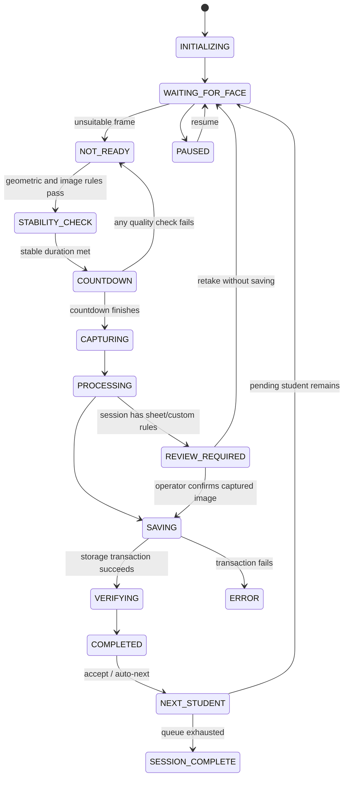

# Fundamentals of AI: ENROLL-AI pipeline

The project separates institutional student identity from visual perception. Enrollment numbers and names are database records chosen by the operator. Computer vision supplies only photo-quality evidence.

## 1. Perception — `src/vision/faceDetector.ts`

The pretrained MediaPipe BlazeFace short-range detector performs neural inference on a reduced-resolution camera frame. Each detected object supplies a bounding box and six keypoints. The adapter normalizes geometry by image width/height and estimates absolute head roll from the eye-point line. No face embedding, identity label, database comparison or skin-color fallback is implemented.

The model is not trained by this project. Model weights are versioned, downloaded from Google’s official MediaPipe model storage and verified using SHA-256. Inference uses the CPU locally. Detection confidence is a model output about face presence, not the probability that a student is a particular person.

## 2. Feature extraction and rule evaluation — `src/vision/qualityEngine.ts`

- **Geometry:** the face center must be within configurable normalized tolerances around the framing target; normalized height must be between the minimum and maximum.
- **Head roll:** the eye-line angle must be below the configured tolerance. This is not a complete three-dimensional pose estimator.
- **Luminance:** convert face-region RGB values to gray using `0.2126R + 0.7152G + 0.0722B`. Measure the mean and the fraction of clipped dark/bright pixels.
- **Sharpness:** convolve the grayscale region with the four-neighbor Laplacian `[0,1,0; 1,-4,1; 0,1,0]`. Compute variance as `E[L²] − E[L]²`. A low value is treated as insufficient sharpness; the threshold depends on optics, resolution and scene texture.
- **Temporal stability:** compare face position and size against an anchored measurement. Large displacement, stale input or a failed quality rule resets the hold duration. An anchor prevents gradual drift from passing solely because consecutive frames are close.

`ready` is a conjunction of all checks, including one face and the stable duration. The app displays measured values and pass/fail results instead of an uncalibrated percentage “AI quality score.” It never generates random scores.

## 3. Decision and action — `src/services/session/captureController.ts`

The controller is a deterministic, rule-based agent around a learned perception model. It is not a learned reinforcement-learning policy. UI components subscribe to snapshots; camera frames supply quality events. Monotonic timestamps drive countdown and preview acceptance, avoiding overlapping uncontrolled timers.

Identity is copied before asynchronous processing. Locks prevent competing capture, skip, selection or next events while encoding and saving. The store verifies both student association and enrollment-derived filename. The JPEG write, completed status and audit event commit together, or all roll back.

Session sheet/hand/custom rules use human review of the captured image, not machine perception. `REVIEW_REQUIRED` cannot auto-advance, be bypassed by manual capture, or inherit confirmation from a previous image. Camera restart and pause/resume preserve the pending review. Rule edits use the capture Web Lock, and storage checks rule revisions again before saving. Confirmation metadata describes an operator decision; it is not an AI compliance result.

## Evidence and limitations

Automated tests validate the deterministic rules and controller decisions, plus actual inference on an isolated public portrait fixture. They do not establish demographic accuracy, real-world identity accuracy (which is explicitly out of scope), liveness, or performance across all devices. A real deployment should measure false-ready/false-reject behavior with consented, representative photos and the institution’s requirements before choosing final thresholds.
