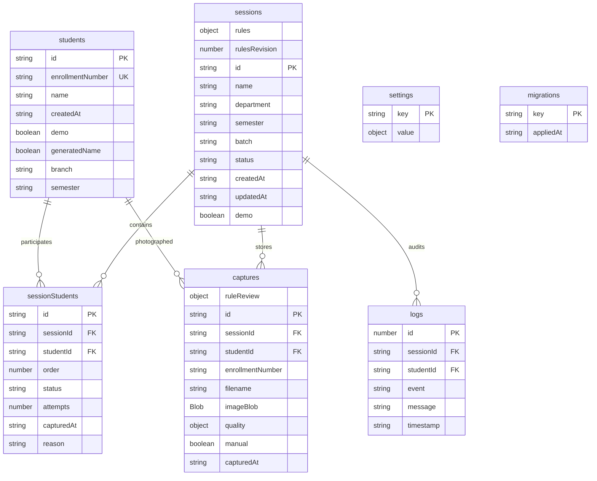

# Local storage schema

The V1 product uses Dexie/IndexedDB with explicit unique indexes. Schema revision 2 migrates existing captures to add a normalized filename index without deleting photos. Revision 3 adds a `migrations` receipt store for the user-requested AIML Semester 5 roster. Its one-time installation uses one transaction across students, sessions, sessionStudents, logs and migrations, preserving existing enrollment records. Future changes must add a Dexie migration; do not delete or recreate an existing database.

Revision 4 adds default session rules (`requireSheet: false`, empty instructions) and revision 0 without altering existing photographs. New captures include a rules snapshot, revision, review method and operator confirmation timestamp when required. Saving checks the current revision and confirmation in the same transaction as photo/status/audit writes. Existing photographs without this evidence are never backfilled as approved. Exports freeze photo Blob references and report rows together in a readonly transaction, so later edits cannot mix old photos with new report metadata.

Both sessionStudents and captures have unique compound `[sessionId+studentId]` indexes. Captures also enforce unique `[sessionId+filenameKey]`, where filenameKey is the lowercase filename. Captures use a deterministic `sessionId:studentId` primary key so an approved retake replaces the photo. Case-normalized, sanitized filename collisions are rejected during import and rechecked when saving. Referential validity is checked in transactions because IndexedDB does not enforce foreign keys. List views keep metadata in state and load only visible photo thumbnails; folder export reads one image at a time.

Timestamps are ISO-8601 UTC. Display uses Asia/Kolkata. No identity prediction or face-template field exists. Quality metadata contains composition and image metrics only.
